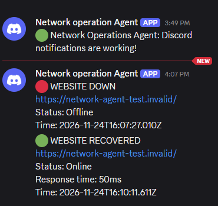

# Network Operations Agent

An AI-powered network monitoring and operations agent built using **Cloudflare Workers, Durable Objects, TypeScript and Workers AI**.

The project monitors website availability, detects outages, tracks incident history, calculates reliability metrics and sends automated Discord notifications when websites go down or recover.

The goal is to demonstrate how cloud infrastructure, persistent state, automation and AI can work together to support network operations.

## Features

### 1. Automated Network Monitoring
- Monitors multiple website endpoints.
- Runs automatically every five minutes using Cloudflare Cron Triggers.
- Measures HTTP status codes and response times.
- Detects unavailable endpoints and connection failures.
- Uses request timeouts to prevent checks from hanging.

### 2. Persistent Incident Management
- Records website outages with timestamps.
- Tracks active and resolved incidents.
- Prevents duplicate incident creation.
- Maintains incident history using Cloudflare Durable Objects.
- Preserves monitoring state across Worker restarts.

### 3. Network Reliability Analytics
- Calculates website uptime percentages.
- Measures average response times.
- Identifies the slowest websites.
- Calculates total and average downtime.
- Identifies the most unreliable websites.
- Tracks ongoing outages and their duration.

### 4. Discord Alerting
- Sends automatic notifications when a website becomes unavailable.
- Sends recovery notifications when a website returns online.
- Prevents repeated alerts for ongoing incidents.
- Records notification timestamps and delivery status.
- Handles Discord delivery failures without stopping scheduled monitoring.

### Discord Notification Examples

The agent sends Discord notifications when an outage is detected and when the affected website recovers.



### 5. AI-Powered Network Operations
- Accepts natural-language questions through an API.
- Identifies user intent and routes requests to the appropriate operation.
- Retrieves monitoring and incident information.
- Uses Workers AI to explain operational results.

Example questions:

- Which websites are currently offline?
- Show me the recent network checks.
- Which website has the worst uptime?
- What are the longest-running incidents?
- Show me the total downtime for each website.

The application uses deterministic intent routing for operational actions, with AI used to interpret and explain the results.

## Technology Stack

| Technology | Purpose |
|---|---|
| TypeScript | Application development |
| Cloudflare Workers | Serverless application runtime |
| Cloudflare Durable Objects | Persistent state and incident management |
| Cloudflare Workers AI | Natural-language processing and explanations |
| Cloudflare Cron Triggers | Automated monitoring |
| Discord Webhooks | Outage and recovery notifications |
| Wrangler | Local development and deployment |
| GitHub | Version control |

## Architecture

The application follows a serverless architecture.

1. Cloudflare Cron Triggers invoke the scheduled monitoring function every five minutes.
2. The monitoring function checks configured website endpoints.
3. Results are recorded in the Network Operations Agent.
4. The Agent maintains persistent monitoring and incident state through Durable Objects.
5. New incidents trigger Discord outage notifications.
6. Resolved incidents trigger Discord recovery notifications.
7. Users can query monitoring information through the `/ask` API endpoint.
8. Workers AI generates explanations based on the retrieved operational data.

## Project Structure

```text
network-operations-agent/
│
├── src/
│   ├── index.ts
│   └── env.d.ts
│
├── docs/
│   └── images/
│       └── discord-notifications.png
│
├── worker-configuration.d.ts
├── wrangler.jsonc
├── package.json
├── package-lock.json
├── tsconfig.json
├── .gitignore
└── README.md
```

The `.dev